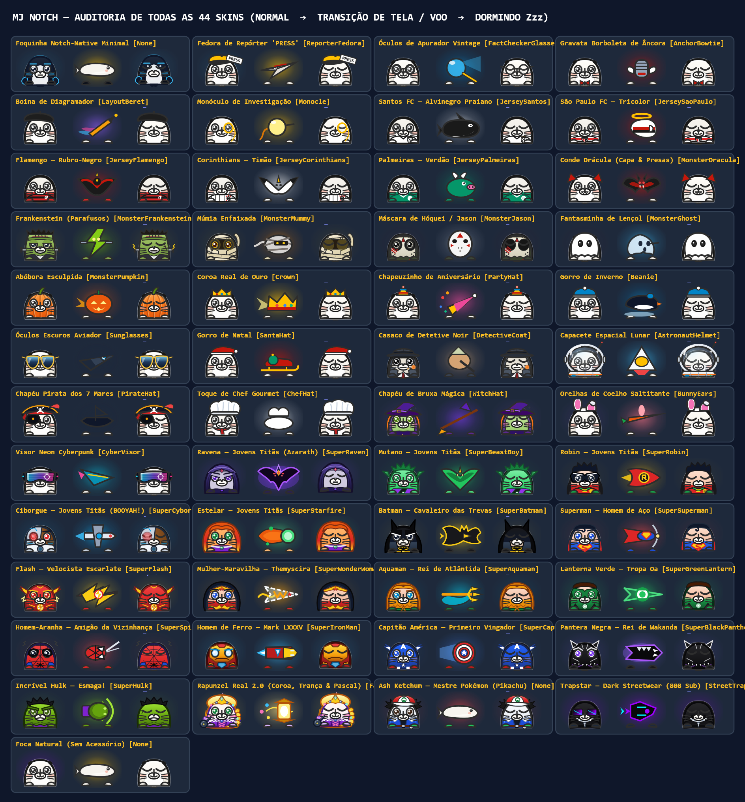
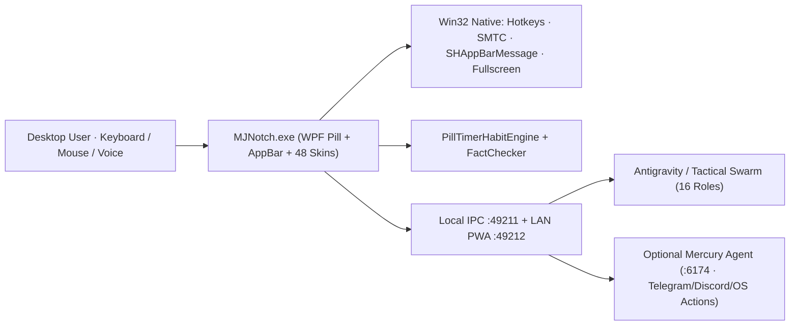

# MJ Notch Companion v9.0 (Open Edition)

[English](README.md) · [简体中文](README.zh-CN.md) · [Português (Brasil)](README.pt-BR.md) · [Interactive Showcase Site](docs/index.html)

A native Windows 10/11 desktop Dynamic Island (`Floating Pill` + `Docked AppBar`) with a reactive 60fps companion mascot (**Foquinha**), hardware/AI telemetry, multi-monitor flight, WinRT media control, Pomodoro + habits (`ExpandPillTimers`), 16-specialist Swarm Inspector, offline PT-BR voice routing, and optional Mercury Agent (`127.0.0.1:6174`) integration.

> Distributed as compiled Windows binaries + native C++ Win32 Setup Installer (`MJNotchSetup.exe`) + portable AI Agent Skills + Showcase Website + 30s Showreels. Personal journalism/domain corpora are stripped out of this public build.

---

## Video Showreels (1080p, 30s each)

| Reel | Coverage | File |
|---|---|---|
| **Reel 01: Product & Architecture** | Pill/AppBar morph, CPU tremor, Fullscreen auto-hide, Pomodoro, Swarm, Voice, C++ Setup | [media/MJNotch_Reel_01_Showreel_30s.mp4](media/MJNotch_Reel_01_Showreel_30s.mp4) |
| **Reel 02: All 48 Foquinha Skins** | All 48 skin costumes, flight morph & sleep Zzz beats (3.0s showcase acts) | [media/MJNotch_Reel_02_All48Skins_30s.mp4](media/MJNotch_Reel_02_All48Skins_30s.mp4) |

---

## Two Cohesive Visual Modes (Zero Cloud Required)

Every major menu adapts automatically between **Floating Pill** and **Docked AppBar**:

| Mode | Aesthetic Language | Palette Tokens | Trigger |
|---|---|---|---|
| **Floating Pill** | Editorial Newsprint + NeoBrutalist Ink | `#F7F4EE` paper, `2px #2D2D2D` border, hard offset shadow | `Ctrl+Alt+A` |
| **Docked AppBar** | Apple Hardware Graphite / Light Hairline | `#111113` dark / `#FFFFFF` light, `1px #27272A` hairline | `Ctrl+Alt+A` |

---

## Core Capabilities

### 1. Living Companion & Sensory CPU Telemetry (`DotConnection`)
- **CPU Load Dot:** 8px green (`< 45%`), yellow (`45-70%`), orange (`70-90%`), 11px red (`>= 90%`) triggering mascot CPU panic tremor until load drops cleanly.
- **Centered Blink & Call States:** Fixed `EyeBlink` squint geometry (`CenterY = 23`), animated vintage telephone handset with distinct ringing waves vs active call chatter, plus one-click system tray mute toggle.
- **48 Collectible Skins + Companion Pets:** Full skin studio (`Ctrl+Alt+G`), search, favorites, and instant live swap across desktop and LAN mobile PWA.

### 2. ExpandPillTimers (`Ctrl+Alt+T`) & Subagent Inspector (`Ctrl+Alt+S`)
- **ExpandPillTimers Drawer:** Configurable Focus/Break presets (`15/3`, `25/5`, `45/10`, `50/10`) or custom minutes, persistent daily habit checklist (`timers_habits.json`) with streak counters, audio toggle, left-click badge to open config / right-click for quick Play/Pause.
- **Tactical Swarm Inspector:** Clean wrap-chip layout with zero horizontal scrollbar clutter, real-time subagent role/tool/thinking inspector, direct notch messaging buffer, and one-click `Verify` handoff.

### 3. Unified Fact-Checking & Verification (`Ctrl+Alt+J`)
Verification triggers directly from:
- **Clipboard Vault** rows
- **Edge File Shelf** staged files & **Hover Edge Shelf** cards
- **Quick Chat** answers (`Ctrl+Shift+Space`)
- **Subagent Inspector** outputs (`Ctrl+Alt+S`)
- **ZapFast** chat message bubbles

### 4. Kobi-Style Desktop Ergonomics & Media Control
- **Fullscreen Auto-Hide:** `SHQueryUserNotificationState` + foreground bounds detection hides overlays cleanly during fullscreen video/games without stealing focus.
- **Multi-Monitor Drag & Snap:** Drag Floating Pill across monitors and persist per-display dock anchors.
- **WinRT SMTC Media Playback:** Event-driven (`MediaPropertiesChanged` / `PlaybackInfoChanged`) Spotify, browser, and local player title + Play/Pause/Prev/Next inside Notch and AppBar.
- **Offline Voice Bridge:** Optional modular Vosk STT + Piper TTS wake-word (`Oi Foquinha, ...`) router targeting local agents without cloud API burn.

### 5. Mercury Agent Integration (`127.0.0.1:6174`) & PC App Automation
Can an AI assistant connected to MJ Notch control local desktop apps such as opening Spotify and starting a playlist?
Yes: when paired with a local automation runtime like **Mercury Agent** (`cosmicstack-labs/mercury-agent`, MIT license) running on `127.0.0.1:6174`:
1. MJ Notch connects to Mercury's local HTTP/WebSocket status endpoint (`127.0.0.1:6174`) without duplicating daemon processes.
2. You can instruct the local agent (via voice or prompt) to launch desktop applications (`spotify.exe`), play music, run builds, or automate system workflows while reporting live task status, daily token `/budget` percentage, and Telegram/Discord/Slack/Signal notifications directly onto the Notch strip.
3. Once Spotify or a browser begins playing, MJ Notch's built-in WinRT SMTC monitor picks up track metadata automatically so Play/Pause/Skip stay one click away.

---

## Architecture

---

## Quick Installation (Native C++ Win32 Setup)

1. Download or run [`installer/MJNotchSetup.exe`](installer/MJNotchSetup.exe).
2. The native Win32 C++ installer extracts the self-contained `.NET 8` runtime to `%LOCALAPPDATA%\Programs\MJNotch`, creates Desktop & Start Menu shortcuts, optional Windows startup registration, and registers clean uninstallation in **Add or Remove Programs** (`unins000.exe --uninstall`).
3. Silent flags: `MJNotchSetup.exe --silent` or `MJNotchSetup.exe --uninstall --silent`.

---

## Keyboard Shortcuts

| Shortcut | Action |
|---|---|
| `Ctrl + Alt + A` | Toggle Floating Pill <-> Docked AppBar |
| `Ctrl + Alt + T` | Open ExpandPillTimers (Pomodoro & Daily Habits) |
| `Ctrl + Alt + S` | Open Tactical Swarm Subagent Inspector |
| `Ctrl + Alt + J` | Open Fact-Check / Claim Verifier |
| `Ctrl + Alt + G` | Open Mascot Wardrobe & 16-Agent Dormitory |
| `Ctrl + Alt + N` | Toggle Newsprint Light <-> Graphite Dark Theme |
| `Ctrl + Shift + Space` | Open Quick Chat |
| `Ctrl + Shift + O` | Screen Lasso Capture + OCR + Verify |

---

## Included Portable AI Skills (`skills/`)

Install any skill folder under `skills/` into `~/.gemini/config/skills/`:

- [`skills/mj-notch-companion`](skills/mj-notch-companion/SKILL.md) - HTTP IPC telemetry, drag-drop staging, mascot reactions & hotkeys
- [`skills/auto-organizer`](skills/auto-organizer/SKILL.md) - Deterministic `organizer.md` 70k-token context checkpointing
- [`skills/tactical-swarm`](skills/tactical-swarm/SKILL.md) - Queen Orchestrator + 16 specialist routing with minimal token burn
- [`skills/graphify-claude-mem`](skills/graphify-claude-mem/SKILL.md) - AST code graph + persistent SQLite session memory workflow
- [`skills/agent-computer-openbot`](skills/agent-computer-openbot/SKILL.md) - Browser / Filesystem / Terminal human-in-the-loop handoff
