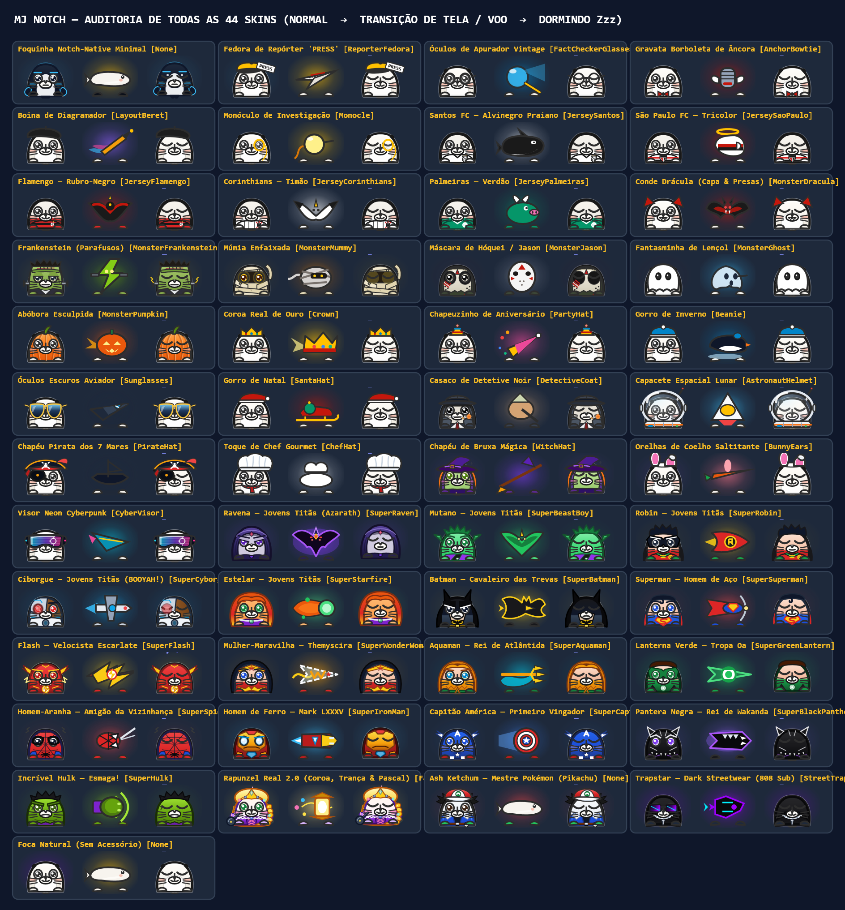

# MJ Notch Companion v9.0 (Open Edition)

[English](README.md) · [简体中文](README.zh-CN.md) · [Português (Brasil)](README.pt-BR.md) · [Site Showcase Interativo](docs/index.html)

Ilha Dinâmica nativa para Windows 10/11 (`Floating Pill` + `AppBar Acoplada`) com mascote animada em 60fps (**Foquinha**), telemetria de CPU/GPU e cota de IA, voo entre múltiplos monitores, controles de mídia WinRT SMTC, Pomodoro e hábitos configuráveis (`ExpandPillTimers`), Inspetor de 16 Subagentes, ponte de voz offline PT-BR e integração modular com o **Mercury Agent** (`127.0.0.1:6174`).

> Repositório focado em distribuição compilada pronta para uso: **Instalador Nativo C++ Win32 (`MJNotchSetup.exe`)**, Skills portáteis para agentes, documentação trilíngue, site interativo e dois vídeos de 30 segundos. Todos os bancos de domínio privados e personas pessoais foram removidos desta edição aberta.

---

## Vídeos Showreel (1080p, 30s cada)

| Vídeo | Destaques | Arquivo |
|---|---|---|
| **Reel 01: Produto & Arquitetura** | Transição Pílula/AppBar, tremor de CPU, Fullscreen Auto-Hide, Pomodoro, Subagentes, Voz e Setup C++ | [media/MJNotch_Reel_01_Showreel_30s.mp4](media/MJNotch_Reel_01_Showreel_30s.mp4) |
| **Reel 02: Coleção 48 Skins** | Todas as 48 skins da Foquinha com voo e sono Zzz em atos rítmicos de 3.0s cada | [media/MJNotch_Reel_02_All48Skins_30s.mp4](media/MJNotch_Reel_02_All48Skins_30s.mp4) |

---

## Estética Dual Coerente (Modo Pílula vs Modo AppBar)

Os painéis de **Timers/Hábitos (`ExpandPillTimers`)** e **Subagentes** alternam automaticamente de identidade visual conforme o modo da ilha:

| Modo | Linguagem Visual | Tokens Principais | Atalho |
|---|---|---|---|
| **Modo Pílula (Flutuante)** | Papel Editorial & Neobrutalismo | `#F7F4EE` off-white quente, borda `2px #2D2D2D`, sombra dura | `Ctrl+Alt+A` |
| **Modo AppBar (Acoplada)** | Hardware Grafite Apple (Escuro/Claro) | `#111113` Dark / `#FFFFFF` Light, hairline `1px #27272A` | `Ctrl+Alt+A` |

---

## Funcionalidades Principais

1. **Bolinha de CPU Sensorial (`DotConnection`) & Tremor de Sobrecarga:** Verde 8px (`<45%`), amarela (`45-70%`), laranja (`70-90%`) e vermelha 11px (`>=90%`) fazendo a Foquinha tremer visualmente sob uso extremo de CPU.
2. **Piscada Centralizada & Ligações Cartoon:** Olhos na UTI centralizados (`CenterY = 23`), animação de telefone com ondas sonoras no modo recebendo chamada vs em ligação + silenciador direto no ícone da bandeja do sistema.
3. **ExpandPillTimers (`Ctrl+Alt+T`):** Menu completo para ajustar minutos de Foco/Pausa (`15/3`, `25/5`, `45/10`, `50/10` ou valores livres), adicionar/marcar checklist de hábitos diários com contagem de streak (`timers_habits.json`), clique esquerdo na badge abre o menu e clique direito pausa/retoma rápido.
4. **Inspetor de Enxame Tático (`Ctrl+Alt+S`) & Armário Redesenhado:** Visual limpo seguindo o `DESIGN.md`, chips com quebra automática sem scrollbar horizontal cinza feia, log de raciocínio ao vivo e botão direto `[⚡ APURAR]`.
5. **Fact-Check Integrado em Todos os Módulos (`Ctrl+Alt+J`):** Conectado com **Cofre do Clipboard**, **File Shelf / Hover Edge Shelf**, **Quick Chat**, **Inspetor de Subagentes** e **bolhas do ZapFast**.
6. **Mercury Agent (`127.0.0.1:6174`) e Controle de Apps no PC (ex.: Spotify):**
   Sim! Quando você roda o **Mercury Agent** (MIT) em segundo plano conectado ao MJ Notch, o agente tem acesso local para executar comandos no seu Windows (como abrir o **Spotify**, iniciar uma playlist, gerenciar arquivos ou enviar alertas pelo Telegram/Discord/Slack/Signal) exibindo as tarefas e o limite diário `/budget` direto na barra. Ao iniciar a música no Spotify ou navegador, o monitor **WinRT SMTC** embutido no Notch exibe faixa + controles de Play/Pause/Avançar automaticamente.

---

## Instalação Rápida (Setup Nativo C++ Win32)

1. Baixe e execute [`installer/MJNotchSetup.exe`](installer/MJNotchSetup.exe).
2. O instalador C++ nativo extrai o binário `.NET 8 Self-Contained` para `%LOCALAPPDATA%\Programs\MJNotch` (sem precisar baixar SDKs nem permissão de administrador), cria atalhos na Área de Trabalho/Menu Iniciar e registra desinstalação limpa em **Programas e Recursos** (`unins000.exe --uninstall`).

---

## Atalhos Globais

| Atalho | Ação |
|---|---|
| `Ctrl + Alt + A` | Alternar Modo Pílula <-> Modo AppBar |
| `Ctrl + Alt + T` | Abrir ExpandPillTimers (Pomodoro & Hábitos) |
| `Ctrl + Alt + S` | Abrir Inspetor de Subagentes |
| `Ctrl + Alt + J` | Abrir Fact-Check / Verificador |
| `Ctrl + Alt + G` | Abrir Armário de Skins & Esquadrão |
| `Ctrl + Alt + N` | Alternar Tema Claro Editorial <-> Grafite Escuro |
| `Ctrl + Shift + Space` | Abrir Quick Chat |
| `Ctrl + Shift + O` | Captura Lasso OCR + Fact-Check |

---

## Skills Portáteis Incluídas (`skills/`)

Copie qualquer pasta de `skills/` para `~/.gemini/config/skills/`:
- [`skills/mj-notch-companion`](skills/mj-notch-companion/SKILL.md)
- [`skills/auto-organizer`](skills/auto-organizer/SKILL.md)
- [`skills/tactical-swarm`](skills/tactical-swarm/SKILL.md)
- [`skills/graphify-claude-mem`](skills/graphify-claude-mem/SKILL.md)
- [`skills/agent-computer-openbot`](skills/agent-computer-openbot/SKILL.md)
