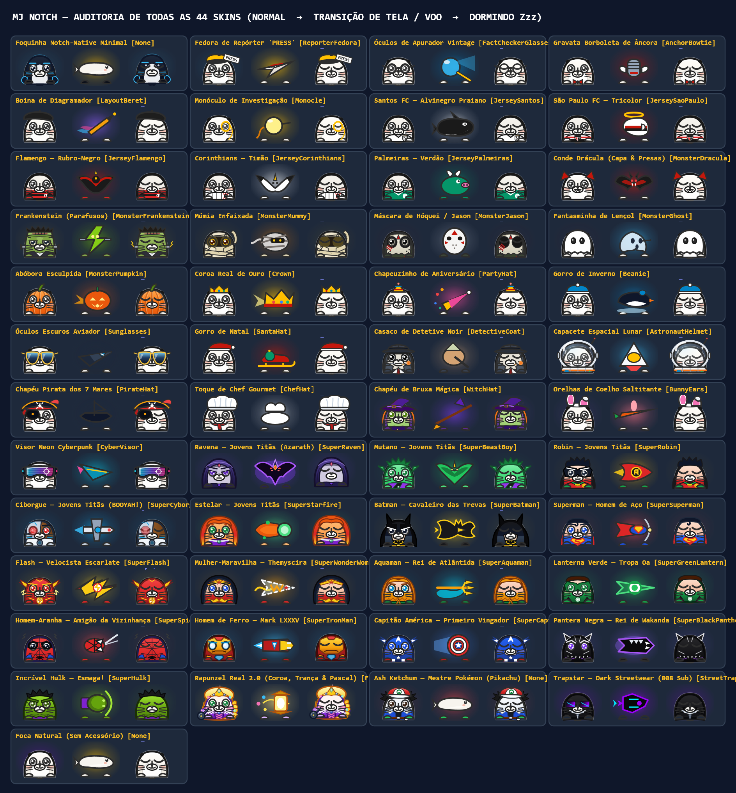
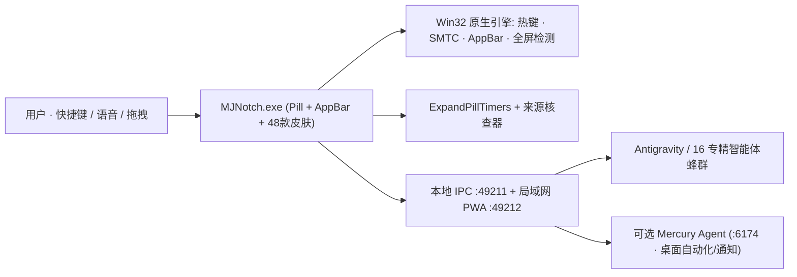

# MJ Notch Companion v9.0 (开源版 / Open Edition)

[English](README.md) · [简体中文](README.zh-CN.md) · [Português (Brasil)](README.pt-BR.md) · [交互式展示站点](docs/index.html)

Windows 10/11 原生桌面动态灵动岛 (`悬浮胶囊 Pill` + `顶部停靠栏 AppBar`)，内置 60fps 响应式海豹吉祥物 (**Foquinha**)、系统与 AI 遥测、跨显示器飞行、WinRT 媒体控制、可配置番茄钟与习惯清单 (`ExpandPillTimers`)、16 角色智能体军团检查器、离线语音桥接以及可选的 **Mercury Agent** (`127.0.0.1:6174`) 集成。

> 本仓库提供完整编译发布的 Windows 原生程序与 **C++ Win32 原生安装程序 (`MJNotchSetup.exe`)**、可移植 AI Agent Skills、多语言视觉文档以及两条 30 秒 1080p 动态演示视频（已移除个人语料库与私有业务配置）。

---

## 30 秒动态视觉展示视频 (1080p)

| 视频 | 内容 | 文件 |
|---|---|---|
| **Showreel 01: 核心功能与双美学** | 胶囊/停靠栏切换、CPU 震颤预警、全屏自动隐藏、番茄钟、16 智能体军团、C++ 安装包 | [media/MJNotch_Reel_01_Showreel_30s.mp4](media/MJNotch_Reel_01_Showreel_30s.mp4) |
| **Showreel 02: 全套 48 款皮肤大赏** | 全数 48 款 Foquinha 皮肤、飞行变形与休眠状态（每段 3.0 秒高光展示） | [media/MJNotch_Reel_02_All48Skins_30s.mp4](media/MJNotch_Reel_02_All48Skins_30s.mp4) |

---

## 双视觉美学系统

所有核心抽屉与检查器面板均根据当前停靠状态自动切换视觉风格：

| 模式 | 视觉风格 | 配色规范 | 快捷键 |
|---|---|---|---|
| **Floating Pill 悬浮胶囊** | 报纸印刷新粗野主义 (Editorial Paper) | `#F7F4EE` 暖纸底色、`2px #2D2D2D` 炭黑描边与硬阴影 | `Ctrl+Alt+A` |
| **Docked AppBar 停靠栏** | 苹果石墨硬件风 (Apple Graphite) | `#111113` 深色 / `#FFFFFF` 浅色、`1px` 细线边框 | `Ctrl+Alt+A` |

---

## 核心功能亮点

1. **CPU 负载感知圆点 (`DotConnection`) & 恐慌震颤：** 绿色 (8px, `<45%`) → 黄色 → 橙色 → 红色 (11px, `>=90%`) 并触发吉祥物实时震颤提醒。
2. **居中眨眼修复与卡通来电动画：** 修正 `EyeBlink` 中心点 (`CenterY = 23`) 避免眯眼偏移；新增听筒响铃声波动画与一键托盘静音开关。
3. **ExpandPillTimers (`Ctrl+Alt+T`)：** 完整番茄钟设置菜单（`15/3`、`25/5`、`45/10`、`50/10` 或自定义分钟数）、每日习惯打卡追踪与连胜记录 (`timers_habits.json`)。
4. **16 角色智能体检查器 (`Ctrl+Alt+S`)：** 流式换行标签布局（消除杂乱横向滚动条）、实时推理日志、直接指令交互及一键事实核查。
5. **全局事实/来源核查整合 (`Ctrl+Alt+J`)：** 已打通剪贴板金库、悬浮文件架 (`Edge Drop Shelf`)、Quick Chat、智能体输出及消息气泡一键核查。
6. **Mercury Agent 本地守护集成 (`127.0.0.1:6174`) 与 PC 桌面控制：**
   当本机运行 **Mercury Agent**（MIT 协议）时，MJ Notch 会连接其 `:6174` 状态端点。你可以直接通过语音或指令让智能体启动 Spotify、播放音乐、执行本地脚本或审计任务，同时在桌面灵动岛实时显示 `/budget` 每日 Token 配额进度及 Telegram/Discord/Slack/Signal 通知；Spotify 开始播放后，内置 WinRT SMTC 监听器会自动同步歌名与播放控制按钮。

---

## 架构概览

---

## 一键安装指南 (C++ Win32 安装包)

1. 运行 [`installer/MJNotchSetup.exe`](installer/MJNotchSetup.exe)。
2. 原生 C++ 安装程序会将自包含运行时解压至 `%LOCALAPPDATA%\Programs\MJNotch`（无需管理员弹窗，无需额外安装 .NET SDK），创建桌面与开始菜单快捷方式，并注册标准 Windows 卸载入口 (`unins000.exe --uninstall`)。
3. 静默参数：`MJNotchSetup.exe --silent` / `MJNotchSetup.exe --uninstall --silent`。

---

## 快捷键一览

| 快捷键 | 功能 |
|---|---|
| `Ctrl + Alt + A` | 切换 悬浮胶囊 ↔ 顶部停靠栏 AppBar |
| `Ctrl + Alt + T` | 打开 ExpandPillTimers（番茄钟与习惯面板） |
| `Ctrl + Alt + S` | 打开 16 智能体检查器 |
| `Ctrl + Alt + J` | 打开 来源/事实核查面板 |
| `Ctrl + Alt + G` | 打开 48 皮肤衣橱与智能体宿舍 |
| `Ctrl + Alt + N` | 切换浅色纸感 / 深色石墨主题 |
| `Ctrl + Shift + Space` | 打开 Quick Chat 浮窗 |
| `Ctrl + Shift + O` | 屏幕套索 OCR 识别 + 核查 |

---

## 随附可移植 Agent Skills (`skills/`)

将 `skills/` 下目录复制至 `~/.gemini/config/skills/` 即可启用：
- [`skills/mj-notch-companion`](skills/mj-notch-companion/SKILL.md)
- [`skills/auto-organizer`](skills/auto-organizer/SKILL.md)
- [`skills/tactical-swarm`](skills/tactical-swarm/SKILL.md)
- [`skills/graphify-claude-mem`](skills/graphify-claude-mem/SKILL.md)
- [`skills/agent-computer-openbot`](skills/agent-computer-openbot/SKILL.md)
